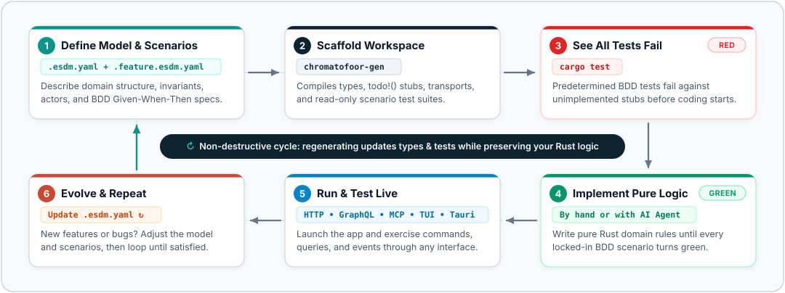

<p align="center">
  
</p>

<p align="center">
  <a href="https://github.com/nanderstabel/chromatofoor/actions/workflows/ci.yml"></a>
  
  
  
</p>

# Chromatofoor

**Event Sourcing, CQRS, Domain-Driven Design, and BDD for Rust.**

Chromatofoor lets you model event-sourced domains, either directly in Rust with `#[chromatofoor::...]` macros or declaratively in [ESDM](https://esdm.io) YAML, and focus strictly on pure business rules. Everything around your domain logic (event streams, read-model projections, sagas, BDD Given-When-Then tests, and HTTP / GraphQL / MCP / TUI / Tauri interfaces) wires up out of the box.

**Why DDD, BDD, and CQRS/ES for agentic programming?** Unstructured "vibe coding" quickly produces unmaintainable codebases. Combining Domain-Driven Design (DDD), Behavior-Driven Development (BDD), and CQRS/ES counters this by expressing technical architecture and concrete behavioral examples directly in business terms (commands, events, invariants, and Given-When-Then scenarios), so business stakeholders, engineers, and AI agents all speak the same language. Instead of letting AI improvise architecture on the fly, Chromatofoor locks down the model, permissions, and executable BDD test suite deterministically upfront, keeping AI strictly under control inside pure domain logic.

**Why the name?** *Chromatofoor* comes from *chromatophores* (Dutch: *chromatofoor*), the biological cells that dynamically adapt their structure and state in response to changing signals. By separating **declarative models**, **deterministic code generation**, and **pure business rules**, Chromatofoor keeps domains malleable as requirements evolve instead of letting them harden into a "Big Ball of Mud".

> [!NOTE]
> **Work in Progress:** Chromatofoor is under active development and APIs may still change. Generated applications currently run against an in-memory event store (`InMemoryEventStore`), so runtime events and read-model state are not persisted to disk across restarts yet.

---

## Try It in 60 Seconds

This repository includes five complete, runnable example domains under [`testbed/`](./testbed/README.md):

```bash
# 1. Launch the HTTP server (with embedded Web Workbench, GraphiQL, OpenAPI, and MCP)
cargo run --manifest-path testbed/05-cargo-shipping/workspace/cargo-shipping/Cargo.toml -p api-server
# -> Open http://localhost:3000/ in your browser (or http://localhost:3000/graphiql)

# 2. Or explore a domain in the interactive terminal UI
cargo run --manifest-path testbed/01-bank-account/workspace/bank-account-example/Cargo.toml -p interactive-tui

# 3. Run the generated Given-When-Then scenario tests
cargo test --manifest-path testbed/01-bank-account/workspace/bank-account-example/Cargo.toml
```

---

## How It Works

<p align="center">
  
</p>

### 1. Model your domain (YAML or Rust macros)

Define bounded contexts, actors, aggregates, commands, events, and read models in `.esdm.yaml` and run `chromatofoor-gen`, or write the same `#[chromatofoor::...]` attributes directly by hand.

From [`testbed/01-bank-account`](./testbed/01-bank-account/model.esdm.yaml):

```yaml
apiVersion: schema.esdm.io/core/v1
kind: command
name: withdraw-funds
description: Withdraws funds from an existing bank account when sufficient balance is available.
scope:
  domain: bank-account-example
  boundedContext: finance
  aggregate: account
actors: [customer]
publishes: [funds-withdrawn]
data:
  type: object
  properties:
    id: { type: string, format: uuid }
    amount: { type: integer, minimum: 1 }
  required: [id, amount]
```

`chromatofoor-gen` compiles this into strongly typed Rust structs with compile-time scope checks, field validation, and fail-closed actor permissions:

```rust
#[chromatofoor::command(scope = Account, validate, actors = [Customer])]
pub struct WithdrawFunds {
    #[validate(range(min = 1i64, message = "Field 'amount' must be at least 1"))]
    pub amount: i64,
    pub id: uuid::Uuid,
}
```

### 2. Formulate behavior with BDD Given-When-Then scenarios

Following Behavior-Driven Development (BDD), formulate concrete domain examples, edge cases, invariant rejections, and actor permissions upfront in `.feature.esdm.yaml` (from [`model.feature.esdm.yaml`](./testbed/01-bank-account/model.feature.esdm.yaml)):

```yaml
apiVersion: schema.esdm.io/given-when-then/v1
kind: feature
name: account-commands
scope:
  domain: bank-account-example
  boundedContext: finance
  aggregate: account
scenarios:
  - name: reject-overdraft-withdrawal
    given:
      - event: account-opened
        data: { owner-name: "Alice", balance: 100 }
    when:
      actor: customer
      command: withdraw-funds
      data: { id: "00000000-0000-0000-0000-000000000001", amount: 150 }
    then:
      rejection:
        invariant: insufficient-funds
```

Because scenarios reference typed domain commands, events, and invariants directly, there is no fragile Gherkin regex or step-definition glue code to maintain. `chromatofoor-gen` compiles every scenario straight into a predetermined, read-only Rust test under `tests/generated/` (`// DO NOT EDIT`), while scaffolding unimplemented domain methods with `todo!(...)`. Every new feature starts in a clean **Red** state, and neither humans nor AI agents can cut corners by weakening assertions:

```rust
#[tokio::test]
async fn test_account_commands_reject_overdraft_withdrawal() {
    chromatofoor::testing::given::<Account>(vec![/* AccountOpened { balance: 100 } */])
        .when_by("customer", AccountCommand::WithdrawFunds(/* amount: 150 */))
        .await
        .then_rejected(AccountError::InsufficientFunds);
}
```

### 3. Write pure domain logic to turn the tests green

You only implement the business decisions and state transitions until `cargo test` passes. Re-running `chromatofoor-gen` updates generated types and scenario tests without overwriting your domain code:

```rust
impl Command<Account> for WithdrawFunds {
    type Error = AccountError;

    async fn decide(self, state: &Account) -> Result<Vec<AccountEvent>, Self::Error> {
        let Account::Created(inner) = state else {
            return Ok(vec![]);
        };
        if self.amount > inner.balance {
            return Err(AccountError::InsufficientFunds);
        }
        Ok(vec![AccountEvent::FundsWithdrawn(FundsWithdrawn {
            amount: self.amount,
            new_balance: inner.balance - self.amount,
        })])
    }
}
```

### 4. Attach presentations and serve

Mount one or more transports onto the built `DomainRuntime`:

```rust
bootstrap::Domain::build()
    .await?
    .attach(
        chromatofoor_http::HttpServer::bind("0.0.0.0:3000")
            .attach(chromatofoor_graphql::GraphQL::new())
            .attach(chromatofoor_mcp::Mcp::http()),
    )
    .serve()
    .await
```

---

## What's Included

- **Zero-glue BDD & predetermined test suites:** `.feature.esdm.yaml` scenarios turn BDD formulation directly into deterministic, in-memory `cargo test` suites across **Aggregates**, **Dynamic Consistency Boundaries**, **Read Models**, and **Process Managers** (verifying emitted events, idempotent no-ops, invariant and actor rejections, query outputs, and saga timers) with no manual step-definition glue, backed by `chromatofoor::testing` for hand-written tests too.
- **Living domain documentation:** Descriptions, invariant rules, actor permissions, and BDD scenario summaries written once in `.esdm.yaml` propagate deterministically into Rust `///` doc comments and live runtime schemas (OpenAPI 3.0, GraphQL, MCP tool descriptions for AI callers, the Web and TUI workbenches, and `chromatofoor-gen visualize`).
- **Complete tactical & strategic DDD building blocks:** Aggregates, Entities, Value Objects, Domain Services, Dynamic Consistency Boundaries (ad-hoc multi-stream consistency), Read Models, Queries, Policies, Event Handlers, and stateful Process Managers with durable timers.
- **Safety by default:** `#![deny(unsafe_code)]`, compile-time scope and lifecycle checks, automatic payload validation, fail-closed actor authorization, and structured RFC 9457 `ProblemDetails` errors across all transports.
- **Plug-and-play interfaces:**
  - **[HTTP (`chromatofoor-http`)](./presentation/http/README.md):** Command `POST` and query `GET` endpoints, SSE event streaming, OpenAPI 3.0 spec (`/openapi.json`), and a built-in Svelte 5 Web Workbench at `/`.
  - **[GraphQL (`chromatofoor-graphql`)](./presentation/graphql/README.md):** Auto-derived queries, mutations, subscriptions, and GraphiQL (`/graphiql`).
  - **[MCP (`chromatofoor-mcp`)](./presentation/mcp/README.md):** Model Context Protocol server (`stdio` or Streamable HTTP at `/mcp`) so AI tools can call commands and queries under the same actor authorization rules.
  - **[Terminal UI (`chromatofoor-tui`)](./presentation/tui/README.md):** Interactive Ratatui terminal workbench for browsing commands, queries, and live events.
  - **[Tauri v2 (`chromatofoor-tauri`)](./presentation/tauri/README.md):** Native desktop and mobile (iOS & Android) apps powered by the shared Svelte 5 workbench, plus generated TypeScript SDKs.

---

## Example Domains

The [`testbed/`](./testbed/README.md) directory walks from a single aggregate up to a multi-context system:

| Example | Domain | Highlights |
| :--- | :--- | :--- |
| **[`01-bank-account`](./testbed/01-bank-account/model.esdm.yaml)** | Retail banking | Aggregates, lifecycle states, actor permissions, read-model projections, Given-When-Then tests. |
| **[`02-ecommerce-checkout`](./testbed/02-ecommerce-checkout/model.esdm.yaml)** | Shopping cart | Nested entities & value objects, schema validation, multi-event invariants. |
| **[`03-course-enrollment`](./testbed/03-course-enrollment/model.esdm.yaml)** | University registration | Dynamic Consistency Boundaries (DCB) across multiple streams and domain services. |
| **[`04-flight-booking`](./testbed/04-flight-booking/model.esdm.yaml)** | Travel booking saga | Cross-context Process Managers, compensating commands, and scheduled timers. |
| **[`05-cargo-shipping`](./testbed/05-cargo-shipping/model.esdm.yaml)** | Freight & cargo routing | Subdomains, Shared Kernel, Policies, External Systems, Anti-Corruption Layers, and all 5 transports. |

---

## Documentation

Alongside propagating domain descriptions from `.esdm.yaml` into generated code and runtime schemas, this repository maintains its own design documents and per-crate `README.md` contracts as **living documentation** verified continuously against the codebase (using the Elephant-Goldfish Model):

- **[Schema-Driven TDD Workflow](./docs/tdd-workflow.md):** Step-by-step guide from `.esdm.yaml` models and `.feature.esdm.yaml` BDD scenarios to working domain code.
- **[Design Specifications](./docs/designs/SITEMAP.md):** Architecture and code-generator specifications.

<details>
<summary><strong>System Architecture & Invariants</strong> (crate boundaries, global invariants, side effects, and verification)</summary>

## Subdirectories & System Boundaries

- **Core Compiler & Runtime Crates**:
  - [`chromatofoor/`](./chromatofoor/README.md): Pure-functional DDD/CQRS/ES runtime (`Aggregate`, `DynamicConsistencyBoundary`, `Command`, `Event`, `ReadModel`, `DocumentView`, `Query`, `Policy`, `EventHandler`, `ProcessManager`, `DomainBuilder`, `DomainRuntime`, `ProblemDetails`, `testing`).
  - [`chromatofoor-derive/`](./chromatofoor-derive/README.md): Procedural attribute macros (`#[chromatofoor::<kind>]`) enforcing compile-time scope hierarchy, `Identified` field validation, lifecycle preconditions, and `Authorized` actor checks.
  - [`esdm/`](./esdm/README.md): ESDM YAML AST, JSON Schema validation (`schemas/`), and cross-document semantic linter (`esdm::lint`).
  - [`chromatofoor-gen/`](./chromatofoor-gen/README.md): Deterministic workspace, domain, integration, BDD test, presentation, and TypeScript SDK generator (plus `chromatofoor-gen visualize` interactive domain graph server).
- **Composable Presentation & UI Adapters**:
  - [`presentation/`](./presentation/README.md): Transport adapter index covering [`presentation/http/`](./presentation/http/README.md) (`chromatofoor-http` + embedded Web Workbench), [`presentation/graphql/`](./presentation/graphql/README.md) (`chromatofoor-graphql`), [`presentation/mcp/`](./presentation/mcp/README.md) (`chromatofoor-mcp`), [`presentation/tui/`](./presentation/tui/README.md) (`chromatofoor-tui`), and [`presentation/tauri/`](./presentation/tauri/README.md) (`chromatofoor-tauri` desktop & mobile IPC).
  - `packages/ui/`: `@chromatofoor/ui` shared Svelte 5 `WorkbenchApp` and component library.
- **Reference Suites**:
  - [`testbed/`](./testbed/README.md): Five canonical DDD reference domains (`01-bank-account` through `05-cargo-shipping`) covering all 18 ESDM `kind`s, runtime semantics, and generator determinism.

## Global Invariants

- **Strict Rust Safety & Lints**: `#![deny(unsafe_code)]`, `clippy::pedantic`, and `deny(unwrap_used, expect_used, panic, todo, unimplemented)` across workspace crates (with scoped allowances in `chromatofoor-gen/src/main.rs` and `chromatofoor/src/testing.rs`). Generated workspaces enforce inherited `unsafe_code = "deny"` and `clippy::todo = "warn"` across all member crates.
- **Macro & Codegen Parity**: `chromatofoor-gen` emits the same `#[chromatofoor::<kind>]` macros and traits used by hand-written Rust domains, sharing a generated `<workspace>/domain` crate.
- **Two-Phase Fail-Closed Authorization**: Commands and queries without declared `actors` reject all actor-checked dispatch (`DispatchError::Unauthorized`), checking caller permissions before deserializing untrusted JSON payloads.
- **Deterministic Non-Destructive Code Generation**: Generated collections and workspace members are sorted deterministically (while `IndexMap`-backed read-model, query, and process-manager fields preserve YAML declaration order); `src/generated/` and `<crate>/tests/generated/` are overwritten cleanly while manual domain files (`src/domain/`, `src/application/read_models/`, `src/infrastructure/`, and `<crate>/tests/*.rs`) are preserved.
- **Immutable Core Schema**: `schemas/core/v1.yaml` is the upstream ESDM core specification; execution extensions (`lifecycle/v1`, `given-when-then/v1`, `infrastructure/v1`, `domain-storytelling/v1`) live in sibling extension schemas.

## Global Side Effects

- Event appends, optimistic concurrency preconditions, and projection/consumer subscriptions run through `architecturekit::Store` (generated `bootstrap` crates currently default to `InMemoryEventStore`, so runtime state is in-memory only unless a persistent `EventStore` is supplied via `Domain::build_with_store`).
- Consumer checkpoints persist to `/checkpoints/<kind>/<domain>/<consumer>`, Process Manager snapshots and outbox `pending_commands` persist to `/process-managers/<domain>/<pm>/<id>`, and fired timer events persist to `/<domain>/<pm>/timers/<id>`.

## System Verification

- Run full workspace tests, strict `clippy`, ESDM model linting, and testbed verification:
  ```bash
  ./scripts/verify_all.sh
  ```

</details>

---

## License

- **Runtime, Macros, Linter, Presentations, UI & Examples** (`chromatofoor`, `chromatofoor-derive`, `esdm`, `presentation/*`, `packages/ui`, `testbed/*`): [MIT License](./LICENSE).
- **Code Generator** (`chromatofoor-gen`): [GNU AGPL-3.0](./chromatofoor-gen/LICENSE) with the [Generated Code Output Exception](./chromatofoor-gen/OUTPUT_EXCEPTION.md) (all workspaces and code generated by `chromatofoor-gen` are unencumbered and owned by you).
- **Upstream ESDM Schemas** (`schemas/core/v1.yaml`, `schemas/given-when-then/v1.yaml`, `schemas/domain-storytelling/v1.yaml`): Copyright (c) 2026 the native web GmbH, [MIT License](./LICENSE).
