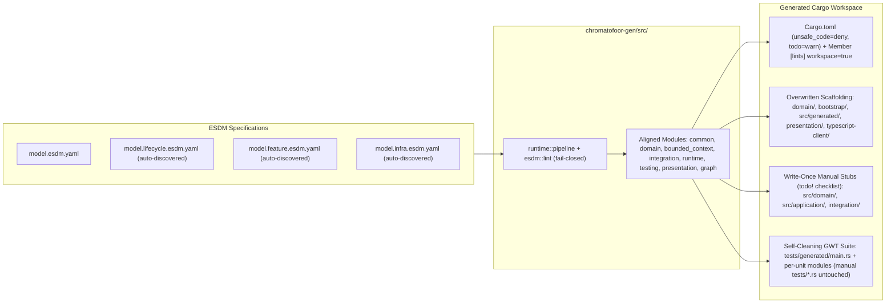

# Compiler Alignment, Explicit Stub Failure, Isolated Generated Tests, and Canonical 5-Testbed Suite

*   **Author:** Nander Stabel
*   **Status:** Approved
*   **Date:** 2026-11-16

--------------------------------------------------------------------------------

## Overview

Chromatofoor is a Rust platform for Domain-Driven Design (DDD), Command Query Responsibility Segregation (CQRS), and Event Sourcing. It consists of three core crates—`chromatofoor` (the runtime engine and testing harness), `chromatofoor-derive` (compile-time procedural macros), and `chromatofoor-gen` (the code generator)—plus `esdm`, which parses YAML specifications written in the Event-Sourced Domain Model (ESDM) schema.

Developers model a business domain in declarative `.esdm.yaml` files (including Given-When-Then behavioral test scenarios in `.feature.esdm.yaml`), run `chromatofoor-gen` to generate a Cargo workspace of Rust crates and executable tests, and then implement the business logic inside manual Rust stub files until all tests pass.

This design aligns `chromatofoor-gen`'s internal module layout and generated workspace contracts with `chromatofoor` and `chromatofoor-derive`, replaces silent placeholder return values in newly generated stubs with explicit failure markers, isolates generated Given-When-Then test files from hand-written integration tests, and replaces the repository's eight pre-refactor testbeds with five domain-agnostic, progressive DDD reference domains (`01` through `05`) that cover every ESDM construct.

## The Problem

Following a major refactor of `chromatofoor` and `chromatofoor-derive`, four gaps weaken the workflow for developers, AI coding agents, and framework maintainers:

1.  **Unimplemented stubs fail to signal missing business logic**: Today, `chromatofoor-gen` populates newly generated manual implementation files with silent no-op bodies (`Ok(vec![])`, `Ok(())`, `Vec::new()`, or returning state unchanged). Scenarios expecting zero emitted events pass on day one before any logic is written, read-model scenarios specifying expected query results or rejections currently emit no test assertions at all, and commands or consumers without test scenarios pass both `cargo test` and `cargo clippy` indefinitely. Across the repository's existing testbeds, 70 stub files remained silently unimplemented behind passing CI builds.
2.  **Generated workspaces omit declared safety and lint contracts**: Although the repository root contract states that `chromatofoor-gen` outputs workspaces forbidding `unsafe` Rust code, generated workspace manifests omit `[workspace.lints]` definitions and member-crate lint inheritance, and CI never runs `cargo clippy` on generated testbed workspaces.
3.  **Generated and hand-written integration tests share the same flat folder**: `chromatofoor-gen` writes generated scenario tests directly into `<crate>/tests/` alongside developer-written integration tests. When a domain unit or feature is renamed or deleted in YAML, `chromatofoor-gen` cannot safely clean up obsolete generated test files without risking deletion of developer-written tests. Conversely, omitting the `--features` CLI flag does not auto-discover a sibling `model.feature.esdm.yaml` file.
4.  **Drifted compiler internals and high-maintenance legacy testbeds**: Inside `chromatofoor-gen`, internal module boundaries diverge from `chromatofoor` and `chromatofoor-derive` (for example, naming the tactical bounded-context generator `domain.rs` and bundling workspace, bounded-context, and presentation emitters into one large file). Meanwhile, the eight checked-in testbeds (`01`–`08`) predate the core refactor, carry domain-specific experiments with unfinished stubs, and create high maintenance overhead without offering a clear beginner-to-advanced DDD learning path.

## Goals

*   **Align compiler internal boundaries**: Reorganize `chromatofoor-gen`'s internal source modules so every DDD, CQRS, and Event Sourcing concept lives under the same module names used by `chromatofoor` and `chromatofoor-derive` (`common`, `domain`, `bounded_context`, `integration`, `runtime`, `testing`), alongside explicit sibling modules for `presentation` and `graph` tooling, with zero breaking changes to generated bounded-context source paths.
*   **Enforce workspace safety and lint burndown in generated projects**: Emit workspace-level `unsafe_code = "deny"` and `clippy::todo = "warn"` lint rules inherited by every generated member crate, so local `cargo clippy` runs list unfinished stubs as warnings while CI gates (`-D warnings -D clippy::todo`) reject unfinished stubs and `unsafe` blocks.
*   **Fail Red-phase business logic deterministically**: Emit explicit `todo!(...)` failure markers in newly scaffolded manual business-logic hooks and emit complete assertions for read-model query result and rejection scenarios, verified automatically in CI via an ephemeral temporary-directory generation test.
*   **Isolate and self-clean generated Given-When-Then tests**: Emit all generated scenario tests inside `<crate>/tests/generated/` (using Cargo's multi-file `tests/generated/main.rs` convention), auto-discover sibling `model.feature.esdm.yaml` files while failing closed on missing explicit feature paths or YAML parse errors, and deterministically delete stale generated test files without touching developer-authored `<crate>/tests/*.rs` files.
*   **Replace legacy testbeds with five progressive canonical DDD domains**: Remove the eight legacy testbeds and author five compact, domain-agnostic ESDM reference suites ordered from foundational to full strategic DDD (`01-bank-account`, `02-ecommerce-checkout`, `03-course-enrollment`, `04-flight-booking`, `05-cargo-shipping`) that collectively exercise all 18 ESDM core kinds and all extension schemas, scaffolded cleanly into fresh `todo!(...)` workspaces ready for manual implementation.

## Non-Goals

*   **Implementing business logic inside the five regenerated testbeds during automated delivery**: Automated execution stops once the five new testbed workspaces are generated with compiling `todo!(...)` stubs so the author can implement the domain logic manually testbed-by-testbed to validate the end-user Red-to-Green workflow.
*   **Renaming generated bounded-context source folders**: Existing generated paths inside bounded contexts (`src/domain/`, `src/application/`, `src/infrastructure/`, `src/generated/`) remain unchanged.
*   **Splitting generated types and manual trait implementations into separate Cargo crates**: Domain types and their trait implementations remain in the same crate to satisfy Rust's orphan coherence rules.
*   **Maintaining duplicate unimplemented and implemented workspace copies in Git**: Each testbed retains a single `workspace/` directory in version control; the unimplemented Red-phase state is verified ephemerally in temporary directories during test runs.
*   **Modifying upstream ESDM core or behavioral schemas**: `schemas/core/v1.yaml` and `schemas/given-when-then/v1.yaml` remain immutable.

## Open Questions

*   None. All scope, layout, and handoff questions from ideation are resolved.

## Critical User Journeys (CUJs)

### CUJ 1: Red-to-Green Test-Driven Development on a Newly Generated Domain

*   **Given**: A developer defines `model.esdm.yaml`, `model.lifecycle.esdm.yaml`, and `model.feature.esdm.yaml` (including scenarios expecting emitted events, zero events, domain rejections, and read-model query results) and runs `chromatofoor-gen`.
*   **When**: The developer runs `cargo test --all` and `cargo clippy` in the freshly generated workspace before editing any manual files.
*   **Then**: The entire workspace compiles with zero `unsafe` code permitted (`unsafe_code = "deny"`), every scenario exercising manual domain, projection, or process-manager logic fails in `cargo test` with a scope-qualified `not yet implemented` message, and `cargo clippy` prints a warning list of every remaining `todo!` stub without blocking compilation.

### CUJ 2: Evolving Behavioral Scenarios Alongside Hand-Written Integration Tests

*   **Given**: A bounded-context crate contains both generated Given-When-Then tests under `tests/generated/` and custom developer-authored integration tests in `tests/custom_integration.rs`.
*   **When**: The developer renames or deletes a feature or aggregate in YAML and re-runs `chromatofoor-gen --input model.esdm.yaml --out-dir workspace` (without explicitly passing `--features`).
*   **Then**: `chromatofoor-gen` auto-discovers the sibling `model.feature.esdm.yaml` file, regenerates `tests/generated/main.rs` and its per-unit modules, removes obsolete files inside `tests/generated/`, and leaves `tests/custom_integration.rs` untouched.

### CUJ 3: Progressive Learning and Verification Across the Five Reference Testbeds

*   **Given**: A newcomer or framework contributor inspects `testbed/` or modifies `chromatofoor`, `chromatofoor-derive`, or `chromatofoor-gen`.
*   **When**: They progress from `01-bank-account` through `05-cargo-shipping` (or run `./scripts/verify_all.sh` after completing manual implementations).
*   **Then**: Each testbed introduces a distinct tier of classic DDD and Event Sourcing patterns with zero domain-specific clutter, every ESDM `kind` and transport binding is exercised at least once across `01`–`05`, and every core construct maps predictably between `chromatofoor`, `chromatofoor-derive`, and `chromatofoor-gen`.

## Technical Plan (Architecture)

### End-to-End Compiler and Workspace Architecture

### 1. Aligned Compiler Module Boundaries (`chromatofoor-gen/src/`)

To give `chromatofoor`, `chromatofoor-derive`, and `chromatofoor-gen` matching architectural coordinates without changing user-facing paths inside generated bounded contexts, `chromatofoor-gen/src/generator/` is flattened into eight top-level subsystems under `chromatofoor-gen/src/`:

| `chromatofoor-gen/src/` Module | Mirrors in Core Crates | Architectural Responsibility |
| :--- | :--- | :--- |
| `common/` | `chromatofoor::common`, `chromatofoor-derive/src/common.rs` | Shared model contexts, bounded-context directory routing, JSON Schema-to-Rust type/validator translation, Cargo `[lints]` manifest helpers, and deterministic AST/manual file writers. |
| `domain/` | `chromatofoor::domain`, `chromatofoor-derive/src/domain.rs` | Emits the shared leaf `<workspace>/domain` crate (`#[chromatofoor::domain]` and `#[chromatofoor::external_system]`). |
| `bounded_context/` | `chromatofoor::bounded_context`, `chromatofoor-derive/src/bounded_context.rs` | Emits per-bounded-context `Cargo.toml`, `src/lib.rs`, external-system port traits (`src/infrastructure/`), tactical consistency units (`Aggregate`, `DynamicConsistencyBoundary`, `Command`, `Event`, `Entity`, `ValueObject`, `Actor`, `DomainService`), CQRS projections (`ReadModel`, `Query`), and registration preludes. |
| `integration/` | `chromatofoor::integration`, `chromatofoor-derive/src/integration.rs` | Emits cross-context consumer crates (`integration/policies`, `integration/event-handlers`, and `integration/process-managers/<pm>`), including AST-synchronized incremental Process Manager hooks. |
| `runtime/` | `chromatofoor::runtime` | Owns multi-file ESDM ingestion/validation, root `<workspace>/Cargo.toml` emission, and `<workspace>/bootstrap` crate generation (`DomainBuilder<Domain>` wiring plus `#[chromatofoor::subdomain]` and `#[chromatofoor::context_mapping]`, which reference bounded-context types and stay in `bootstrap` to keep `<workspace>/domain` cycle-free). |
| `testing/` | `chromatofoor::testing` | Compiles Given-When-Then `feature` specifications across Aggregates, Dynamic Consistency Boundaries, Read Models, and Process Managers into `<crate>/tests/generated/`. |
| `presentation/` | Repository `presentation/` adapters | Emits active transport server crates (`api-server`, `graphql-server`, `mcp-server`, `interactive-tui`, `tauri-app`) and the feature-gated `typescript-client/` SDK. |
| `graph/` | CLI `--emit-graph` & `visualize` | Serializes the domain relationship graph to JSON and serves the embedded local HTTP visualizer. |

**Snapshot Sequencing Guardrail**: Because `insta` snapshot tests encode the Rust module path of each test in `.snap` filenames, internal `chromatofoor-gen/src/` module relocation runs as an isolated zero-output-diff step before any generated template changes occur.

### 2. Inherited Workspace Safety and Two-Tier Lint Architecture

Under Cargo's workspace lint inheritance rules, root `[workspace.lints]` tables have no effect unless member packages explicitly opt in, and Clippy's `clippy::todo` lint defaults to `allow` (in the `restriction` group) rather than `warn`.

*   **Root Workspace Manifest**: `chromatofoor-gen` emits `[workspace.lints.rust]` with `unsafe_code = "deny"` and `[workspace.lints.clippy]` with `todo = "warn"` into `<workspace>/Cargo.toml`.
*   **Universal Member Opt-In**: Every generated or templated member `Cargo.toml`—`domain`, bounded contexts and shared kernels, `bootstrap`, `integration/policies`, `integration/event-handlers`, `integration/process-managers/<pm>`, `presentation/{api-server,graphql-server,mcp-server,interactive-tui}`, and the Tauri `src-tauri` template—emits `[lints] workspace = true`.
*   **Two-Tier Developer vs. CI Contract**:
    *   *Local Red-to-Green Iteration*: `cargo test` compiles cleanly, and plain `cargo clippy` surfaces every unimplemented `todo!` stub as a non-blocking compiler warning burndown list.
    *   *Completion & CI Gate*: Once business logic is complete, `cargo clippy --workspace --all-targets -- -D warnings -D clippy::todo` enforces zero `unsafe` blocks, zero compiler warnings, and zero remaining `todo!` stubs.

### 3. Explicit `todo!(...)` Manual Scaffold Matrix and Read-Model Assertions

Newly generated write-once manual files (and AST-appended Process Manager hooks) replace silent placeholder bodies with scope-qualified `todo!(...)` expressions while avoiding compiler warnings under Rust 1.95 (`edition = "2024"`):

| Manual Trait / Hook | Previous Silent Body | New Scaffold Contract |
| :--- | :--- | :--- |
| `Command<Unit>::decide` | `Ok(vec![])` | Scope-qualified `todo!(...)`; `#[tracing::instrument]` configured so diverging `!` return types trigger zero `unreachable_code` warnings. |
| `Event<Unit>::evolve` | `state` | Parameter renamed to `_state`; scope-qualified `todo!(...)` noting that stateless audit/notification events may return `_state` unchanged. |
| `Project<Event>::project` | `Ok(())` | Scope-qualified `todo!(...)`. |
| `React<Event>::react` | `Vec::new()` | Scope-qualified `todo!(...)`. |
| `Handle<Event>::handle` | `Ok(())` | Scope-qualified `todo!(...)`. |
| `DomainService` methods | `todo!(...)` | Standardized scope-qualified `todo!(...)` message format. |
| `ProcessManager::{on_event, on_timer}` | `Vec::new()` or compiled `Timer::set()/cancel()` | Trait/type-qualified `todo!(...)` in both initial generation and incremental AST sync, with any YAML-declared `setTimers` / `cancelTimers` embedded directly inside the `todo!(...)` message string (`(declared timers: set=[...], cancel=[...])`). |
| `ProcessManager::has_ended` | `false` | Scope-qualified `todo!(...)` when `endsWhen` is declared in YAML; `false` when `endsWhen` is omitted (perpetual process manager). |

*   **Read-Model Assertion Completion**: Read-model test generation emits `.then_result_json(...)` when `then.result` is present and `.then_rejected_reason(...)` when `then.rejection` is present (alongside existing `.then_read_model_json(...)` support), eliminating vacuous assertion-free read-model tests.
*   **Runtime vs. Unit Test Execution Boundary**: Unit and BDD tests (`chromatofoor::testing::{given, given_read_model, given_process_manager}`) run each aggregate, DCB, read model, or process manager in isolation, so unrelated `todo!` stubs never interfere during Red-to-Green development (while empty-history scenarios testing macro-generated actor authorization or schema validation continue to pass immediately by design). Because `bootstrap::Domain::build()` subscribes all registered consumers to the domain event stream, full presentation servers (`api-server`, `interactive-tui`, `mcp-server`) are started after subscribed downstream projections and consumers for the active event flow are implemented.

### 4. Isolated Generated GWT Suite (`<crate>/tests/generated/main.rs`) and Fail-Closed Feature Ingestion

*   **Cargo Multi-File Integration Target**: For every bounded-context crate and process-manager crate that produces at least one generated test module, `chromatofoor-gen` wipes and recreates `<crate>/tests/generated/` containing:
    *   `main.rs`: Crate-root attributes (`#![allow(unused_imports, clippy::unwrap_used, clippy::expect_used, clippy::panic)]`) and sorted `mod <module>;` declarations.
    *   Per-unit module files disambiguated by kind (`aggregate_<name>.rs`, `dcb_<name>.rs`, `read_model_<name>.rs`, or `process_manager_<name>.rs`), with scenario test functions qualified by feature name (`test_<feature>_<scenario>`) so multiple `feature` documents targeting the same unit never collide.
*   **Zero-Scenario Cleanup & Legacy Banner Migration**: Test generation iterates across *all* bounded contexts and process managers in the workspace in a single atomic pass. If a crate has zero generated test modules, `<crate>/tests/generated/` is removed completely. Top-level `<crate>/tests/*.rs` files are never touched unless they carry the exact `// ⚠️ DO NOT EDIT ⚠️` generator header (allowing legacy flat `*_tests.rs` files from older generator versions to be cleaned safely without affecting developer-written integration tests).
*   **Fail-Closed `model.feature.esdm.yaml` Auto-Discovery**: Matching `--lifecycle` and `--infra`, `chromatofoor-gen` auto-discovers a sibling `model.feature.esdm.yaml` file next to `--input` when `--features` is omitted, and aborts before modifying any files if an explicit `--features` path does not exist or if any feature YAML document fails parsing.

### 5. Canonical Five-Testbed DDD Suite (`01`–`05`) and Ephemeral Red Verification

The eight legacy testbeds (`01`–`08`) are removed and replaced by five compact, domain-agnostic textbook DDD domains ordered by progressive architectural complexity:

| Testbed | Domain Focus | Cumulative ESDM Coverage |
| :--- | :--- | :--- |
| `01-bank-account` | Personal checking account deposits, withdrawals, and balance projection | `domain`, `bounded-context`, `actor`, `aggregate`, `aggregate-lifecycle`, `command`, `event`, `read-model`, `query`, `feature` |
| `02-ecommerce-checkout` | Shopping cart line items, shipping address, and checkout | Adds `entity`, `value-object`, JSON Schema `length`/`range`/`nested` validation, and validation/invariant rejection scenarios |
| `03-course-enrollment` | University course capacity and student enrollment limits | Adds `dynamic-consistency-boundary` (`consults` across streams) and `domain-service` |
| `04-flight-booking` | Multi-step flight, hotel, and payment timeout saga | Adds multi-BC `context-mapping`, `process-manager` (`startsWhen`/`endsWhen`), compensating commands, and `ProcessTimer` deadlines |
| `05-cargo-shipping` | Freight booking, voyage routing, customs handling, and billing | Adds `subdomain` (`core`, `supporting`, `generic`), `shared-kernel` tier, `external-system`, `policy`, `event-handler`, and `presentation-binding` (`http-rest`, `graphql`, `mcp`, `cli`, `tauri-ipc` + `typescript-client/`) |

*   **Ephemeral Red-Phase Verification vs. Checked-In Workspace State**:
    *   An automated integration test in `chromatofoor-gen` generates a testbed specification into a temporary directory (`tempdir`), verifies `cargo test --no-run` succeeds with zero non-`todo` warnings, verifies `cargo test` fails on `todo!()`, and verifies `cargo clippy -- -D clippy::todo` fails—permanently testing the unimplemented Red experience without checking duplicate folders into Git.
    *   At the handoff boundary of automated delivery, `testbed/01`–`05/workspace/` are freshly generated in their compiling Red (`todo!`) state (`verify_testbeds.sh` supporting `--red-phase` during handoff and enforcing full `cargo test` + `cargo clippy --workspace --all-targets -- -D warnings -D clippy::todo` + zero-diff regeneration once the author completes manual stub implementation).

## Alternatives Considered

### Alternative A: Restructuring Generated Bounded-Context `src/` Folders to Mirror Compiler Internals

*   **Pros**: Gives generated bounded-context crates identical `src/` subfolder names to `chromatofoor/src/` and `chromatofoor-gen/src/`.
*   **Cons**: Leaks internal compiler organization into user-owned application crates (where domain developers navigate by `domain/`, `application/`, and `infrastructure/` concerns) and breaks manual `use crate::...` imports across existing downstream workspaces.
*   **Reason for Rejection**: Rejected by author: high breaking churn across generated workspaces for low practical benefit to domain developers, whereas aligning `chromatofoor-gen/src/` internally achieves cross-crate maintainability with zero downstream migration cost.

### Alternative B: Splitting Generated Domain Types and Manual Trait Implementations into Separate Cargo Crates

*   **Pros**: Enforces a hard Cargo crate boundary between machine-overwritten types and developer-written business logic.
*   **Cons**: Fails to compile under Rust's orphan coherence rule (`E0117`) because core traits (`Command`, `Event`, `Project`, `React`, `Handle`, `OnEvent`, `OnTimer`) live in `chromatofoor`; implementing a foreign trait on a type generated in another crate is rejected by `rustc` unless `chromatofoor-gen` synthesizes per-crate shadow traits, which breaks canonical parity with hand-written `#[chromatofoor::<kind>]` code.
*   **Reason for Rejection**: Rejected by author: blocked by Rust's orphan rule (`E0117`) and incompatible with canonical macro parity.

### Alternative C: Single Consolidated `<crate>/tests/generated.rs` File with Inline Modules

*   **Pros**: Writes all generated Given-When-Then tests for a crate into a single file, avoiding directory management while still compiling a single integration test binary.
*   **Cons**: Concatenates every aggregate, Dynamic Consistency Boundary, and read-model test suite into one large source file, reducing readability when inspecting or debugging generated test code for a single domain unit.
*   **Reason for Rejection**: Rejected by author: author prefers Cargo's `<crate>/tests/generated/main.rs` directory layout with separate per-unit files (`aggregate_<name>.rs`, `dcb_<name>.rs`, `read_model_<name>.rs`, `process_manager_<name>.rs`), which compiles the same single integration binary while keeping per-unit test files small and navigable.

### Alternative D: Maintaining Two Checked-In Workspaces (Unimplemented and Implemented) per Testbed

*   **Pros**: Allows human readers browsing GitHub to inspect both the initial unimplemented Red-phase workspace and the finished Green-phase workspace side by side.
*   **Cons**: Doubles the testbed footprint from 5 Cargo workspaces back to 10 in Git, doubles compilation and regeneration maintenance, and requires special-cased inverted failure checks in CI scripts for the 5 unimplemented workspaces.
*   **Reason for Rejection**: Rejected by author: checking in one implemented Green workspace per testbed while running an automated ephemeral `tempdir` Red-phase test in CI verifies both lifecycle states on every build without doubling repository maintenance.

### Alternative E: Retaining All Eight Legacy Testbeds (`01`–`08`) and Patching Their 70 Stubs in Place

*   **Pros**: Preserves existing experimental domains (`04-virtual-apartment`, `07-life-chart`, `08-digital-identity-ecosystem`) without authoring new ESDM models.
*   **Cons**: Keeps pre-refactor workspaces with uneven design quality, ties the repository to domain-specific experiments rather than classic DDD problem spaces, and saddles every future generator change with maintaining and compiling eight workspaces.
*   **Reason for Rejection**: Rejected by author: keep the repository domain-agnostic and lower ongoing maintenance by replacing the eight legacy testbeds with five progressive, textbook DDD reference domains (`01`–`05`) regenerated cleanly from scratch.

### Alternative F: Retaining Silent `Ok(vec![])` / `Ok(())` No-Op Stubs

*   **Pros**: Allows partial workspaces to boot full presentation servers immediately without panicking on unimplemented downstream event subscribers.
*   **Cons**: Causes scenarios expecting zero events (`then: { events: [] }`) to pass falsely in the Red phase without business logic, hides unimplemented commands and projections behind green `cargo test` and `cargo clippy` runs, and gives developers and AI agents no compiler-tracked checklist of unfinished handlers.
*   **Reason for Rejection**: Rejected by author: explicit `todo!(...)` failure markers paired with `clippy::todo = "warn"` make Red-phase test failures deterministic and expose every remaining unimplemented stub directly through `cargo clippy`.

--------------------------------------------------------------------------------

## Non-Functional Requirements

*   **Safety & Data-Loss Prevention**:
    *   Every generated workspace member crate inherits `unsafe_code = "deny"` via `[lints] workspace = true`.
    *   `chromatofoor-gen` fails closed (`anyhow::bail!`) on missing explicit `--features` paths or malformed YAML before touching `<crate>/tests/generated/`, preventing accidental test-suite deletion when regenerating.
    *   Legacy top-level `<crate>/tests/*_tests.rs` files are deleted only if their header matches the exact `// ⚠️ DO NOT EDIT ⚠️` generator sentinel, guaranteeing zero data loss on developer-authored `<crate>/tests/*.rs` files.
*   **Build & CI Performance**:
    *   Consolidating per-unit generated tests under `<crate>/tests/generated/main.rs` links a single integration test binary per crate instead of $N$ separate test binaries, and replacing 8 legacy workspaces with 5 compact workspaces reduces total CI compilation time within `.github/workflows/ci.yml`'s 25-minute budget even after adding `cargo clippy` across testbeds.
*   **Rollout & Determinism**:
    *   Repeated runs of `chromatofoor-gen` on identical YAML inputs produce byte-identical files (`git diff` exit `0`), verified by `./scripts/verify_testbeds.sh`.

--------------------------------------------------------------------------------

### Additional Resources

*   Core runtime & macro specification: [`runtime-and-macros.md`](./runtime-and-macros.md)
*   Existing generator specification: [`code-generator.md`](./code-generator.md)
*   Schema-driven TDD workflow guide: [`tdd-workflow.md`](../tdd-workflow.md)
*   Generator crate contract: [`chromatofoor-gen/README.md`](../../chromatofoor-gen/README.md)

### Future Improvements

*   **Graceful runtime cushioning for unimplemented stubs**: Catch `"not yet implemented"` unwinds inside `DomainRuntime` command dispatch and background projections (`DispatchError::NotImplemented` / HTTP `501 Not Implemented` and isolated projection warnings) so developers can boot live `api-server`, `mcp-server`, or `interactive-tui` sessions mid-feature while downstream consumers still contain `todo!(...)`.
*   **Deterministic stale-file cleanup inside `<bc>/src/generated/`**: Apply the same directory-reset pattern used for `tests/generated/` to `<bc>/src/generated/` so renaming or deleting an aggregate, command, or event in `model.esdm.yaml` removes obsolete generated source files automatically.

--------------------------------------------------------------------------------

## Detailed Implementation Plan

### Target Files to Create/Modify

Work executes in three incremental phases so every step leaves the repository buildable and verifiable: **Phase 1** (zero-output-diff compiler module relocation and `insta` snapshot migration), **Phase 2** (`[workspace.lints]`, Tauri template compilation/isolation fixes, `mcp` infrastructure schema enum, explicit `todo!(...)` scaffolds, read-model assertion completion, `tests/generated/main.rs` isolation, fail-closed `--features` auto-discovery, and the ephemeral Red-phase integration test), and **Phase 3** (replacing legacy `testbed/01`–`08` with canonical `testbed/01`–`05`, scaffolding fresh Red-state workspaces, and synchronizing verification scripts, structural graph, and EGM contracts).

#### Phase 1: Zero-Output-Diff Compiler Module Alignment (`chromatofoor-gen`)

##### 1. `chromatofoor-gen/src/generator/` and Legacy Top-Level Shims (Delete after extraction)
*   **Files to Delete**:
    *   `chromatofoor-gen/src/model.rs`
    *   `chromatofoor-gen/src/schema_utils.rs`
    *   `chromatofoor-gen/src/generator/mod.rs`
    *   `chromatofoor-gen/src/generator/workspace.rs`
    *   `chromatofoor-gen/src/generator/bootstrap.rs`
    *   `chromatofoor-gen/src/generator/domain.rs`
    *   `chromatofoor-gen/src/generator/domain_service.rs`
    *   `chromatofoor-gen/src/generator/application.rs`
    *   `chromatofoor-gen/src/generator/prelude.rs`
    *   `chromatofoor-gen/src/generator/policies.rs`
    *   `chromatofoor-gen/src/generator/event_handlers.rs`
    *   `chromatofoor-gen/src/generator/process_manager.rs`
    *   `chromatofoor-gen/src/generator/process_manager_tests.rs`
    *   `chromatofoor-gen/src/generator/tests.rs`
    *   `chromatofoor-gen/src/generator/typescript.rs`
    *   `chromatofoor-gen/src/generator/graph.rs`
    *   `chromatofoor-gen/src/generator/visualizer.html`
    *   `chromatofoor-gen/src/generator/snapshots/*.snap` (7 legacy snapshot files relocated to their new module-local `snapshots/` directories)
*   **Rationale**: Removes the monolithic `generator/` module, `src/schema_utils.rs`, and 1-line `model.rs` re-export shim once their logic and unit tests move into the aligned top-level modules below.

##### 2. `chromatofoor-gen/src/common/` (Create: `mod.rs`, `context.rs`, `writer.rs`, `schema.rs`)
*   **Type / Scope**: Rust Compiler Shared Infrastructure Module
*   **Proposed Changes**:
    *   `context.rs`: Relocate `GeneratorContext`, `BoundedContextGenerator`, `RoutingContext`, `resolve_bc_dir`, `format_scope_path`, `format_delivery_and_idempotency_tokens`, `make_doc_comment`, and `get_relative_cargo_path` from `src/generator/mod.rs` (importing `esdm::*` directly instead of `crate::model::*`).
    *   `writer.rs`: Relocate `write_generated_rust_file` (and alias `write_rust_file`), `write_manual_rust_file`, `ensure_manual_mod_file`, private keyword-escaping helper `mod_ident`, and `#[cfg(test)] mod mod_file_tests` from `src/generator/mod.rs`.
    *   `schema.rs`: Relocate `map_type`, `generate_struct_fields`, and `generate_type_for_prop` (plus existing unit tests) from `src/schema_utils.rs`.
    *   `mod.rs`: Re-export `context::*`, `writer::*`, and `schema::*`.
*   **Rationale**: Mirrors `chromatofoor::common` and `chromatofoor-derive/src/common.rs` for cross-cutting compiler utilities.

##### 3. `chromatofoor-gen/src/domain/mod.rs` (Create)
*   **Type / Scope**: Rust Compiler Strategic Domain Emitter
*   **Proposed Changes**: Extract shared `<workspace>/domain` crate generation (`domain/Cargo.toml` and `domain/src/lib.rs` emitting `#[chromatofoor::domain]` and `#[chromatofoor::external_system]`) out of `src/generator/workspace.rs` into `pub fn generate_domain_crate(...)`.
*   **Rationale**: Aligns `chromatofoor-gen/src/domain` strictly with strategic `Domain` emission rather than tactical bounded-context constructs.

##### 4. `chromatofoor-gen/src/bounded_context/` (Create: `mod.rs`, `crate_scaffold.rs`, `consistency.rs`, `application.rs`, `domain_service.rs`, `prelude.rs`, and `snapshots/*.snap`)
*   **Type / Scope**: Rust Compiler Bounded-Context Emitter
*   **Proposed Changes**:
    *   `crate_scaffold.rs`: Extract per-bounded-context `Cargo.toml`, `src/lib.rs`, `src/domain/mod.rs`, and `src/infrastructure/` port scaffolding out of `src/generator/workspace.rs`.
    *   `consistency.rs`: Relocate tactical consistency-unit generation (`generate_domain` renamed to `generate_consistency_units`, plus `generate_actors` and `generate_schema_structs`) and its `insta` snapshot test (`chromatofoor_gen__bounded_context__consistency__tests__domain_generation.snap`) from `src/generator/domain.rs`.
    *   `application.rs`: Relocate `ReadModel` and `Query` generation (`generate_application`) and its `insta` snapshot (`chromatofoor_gen__bounded_context__application__tests__application_generation.snap`) from `src/generator/application.rs`.
    *   `domain_service.rs`: Relocate `generate_domain_services` and its two `insta` snapshots (`chromatofoor_gen__bounded_context__domain_service__tests__domain_service_generation.snap`, `...__domain_service_mod.snap`) from `src/generator/domain_service.rs`.
    *   `prelude.rs`: Relocate `generate_preludes` from `src/generator/prelude.rs`.
    *   `mod.rs`: Re-export `crate_scaffold::*`, `consistency::*`, `application::*`, `domain_service::*`, and `prelude::*`.
*   **Rationale**: Mirrors `chromatofoor::bounded_context` and `chromatofoor-derive/src/bounded_context.rs` while leaving generated `<bc>/src/{domain,application,infrastructure,generated}` output paths unchanged.

##### 5. `chromatofoor-gen/src/integration/` (Create: `mod.rs`, `handler_common.rs`, `policy.rs`, `event_handler.rs`, `process_manager.rs`, and `snapshots/*.snap`)
*   **Type / Scope**: Rust Compiler Cross-Context Integration Emitter
*   **Proposed Changes**:
    *   `handler_common.rs`: Extract `IntegrationHandlerKind` and `generate_integration_handlers` from `src/generator/event_handlers.rs` so `policy.rs` and `event_handler.rs` share a common internal helper.
    *   `policy.rs`: Relocate `generate_policies` and snapshot `chromatofoor_gen__integration__policy__tests__policy_handler_generation.snap`.
    *   `event_handler.rs`: Relocate `generate_event_handlers` and snapshot `chromatofoor_gen__integration__event_handler__tests__event_handler_generation.snap`.
    *   `process_manager.rs`: Relocate `ResolvedPmSpec`, `resolve_pm_event_bc`, `resolve_pm_spec`, `generate_process_managers`, and its unit tests from `src/generator/process_manager.rs`.
    *   `mod.rs`: Re-export `policy::generate_policies`, `event_handler::generate_event_handlers`, and `process_manager::{ResolvedPmSpec, resolve_pm_event_bc, resolve_pm_spec, generate_process_managers}`.
*   **Rationale**: Mirrors `chromatofoor::integration` and `chromatofoor-derive/src/integration.rs`.

##### 6. `chromatofoor-gen/src/runtime/` (Create: `mod.rs`, `pipeline.rs`, `workspace.rs`, `bootstrap.rs`, and `snapshots/*.snap`)
*   **Type / Scope**: Rust Compiler Workspace Composition & Ingestion Pipeline
*   **Proposed Changes**:
    *   `pipeline.rs`: Extract ESDM multi-file loading, indexing, and `esdm::lint::validate_model` orchestration out of `src/main.rs`.
    *   `workspace.rs`: Extract root `<workspace>/Cargo.toml` manifest generation and top-level orchestration calling `domain`, `bounded_context`, `integration`, `runtime::bootstrap`, `testing`, and `presentation`.
    *   `bootstrap.rs`: Relocate `generate_bootstrap_crate` and snapshot `chromatofoor_gen__runtime__bootstrap__tests__bootstrap_generation.snap` from `src/generator/bootstrap.rs`.
    *   `mod.rs`: Re-export `pipeline::*`, `workspace::*`, and `bootstrap::*`.
*   **Rationale**: Mirrors `chromatofoor::runtime` (`DomainBuilder` / `DomainRuntime` composition).

##### 7. `chromatofoor-gen/src/testing/` (Create: `mod.rs`, `bounded_context.rs`, `process_manager.rs`)
*   **Type / Scope**: Rust Compiler Given-When-Then Scenario Emitter
*   **Proposed Changes**: Relocate `src/generator/tests.rs` to `testing/bounded_context.rs` and `src/generator/process_manager_tests.rs` to `testing/process_manager.rs`, re-exported via `testing/mod.rs`.
*   **Rationale**: Mirrors `chromatofoor::testing`.

##### 8. `chromatofoor-gen/src/presentation/` (Create: `mod.rs`, `transports.rs`, `typescript.rs`)
*   **Type / Scope**: Rust Compiler Presentation & TypeScript SDK Emitter
*   **Proposed Changes**:
    *   `transports.rs`: Extract `ActiveTransports` and the five presentation binary emitters (`api-server`, `graphql-server`, `mcp-server`, `interactive-tui`, `tauri-app`) from `src/generator/workspace.rs`, preserving the `../../templates/tauri/...` relative depth for `include_str!`.
    *   `typescript.rs`: Relocate `#[cfg(feature = "typescript")]` `generate_typescript` from `src/generator/typescript.rs`.
    *   `mod.rs`: Re-export `transports::*` and `#[cfg(feature = "typescript")] pub use typescript::*;`.
*   **Rationale**: Aligns transport and frontend SDK generation with the repository's top-level `presentation/` directory instead of mixing UI templates into workspace/domain modules.

##### 9. `chromatofoor-gen/src/graph/` (Create: `mod.rs`, `visualizer.html`) and `chromatofoor-gen/src/main.rs` (Modify)
*   **Type / Scope**: Rust Compiler Graph Exporter, Visualizer Server, & CLI Entrypoint
*   **Proposed Changes**:
    *   Move `src/generator/visualizer.html` to `src/graph/visualizer.html` and merge `emit_graph_file` (from `src/generator/graph.rs`) plus `run_visualizer_server` (from `src/main.rs`, updating `include_str!("visualizer.html")`) into `src/graph/mod.rs`.
    *   Simplify `src/main.rs` to declare `mod common; mod domain; mod bounded_context; mod integration; mod runtime; mod testing; mod presentation; mod graph;`, parse `Cli`, and dispatch to `graph::run_visualizer_server` or `runtime::pipeline::run_codegen`.
    *   **Phase 1 Checkpoint**: Run `cargo test -p chromatofoor-gen --all-features`, `cargo clippy -p chromatofoor-gen --all-targets --all-features -- -D warnings`, and `./scripts/verify_testbeds.sh` to confirm zero git diffs across existing generated workspaces before starting Phase 2.
*   **Rationale**: Isolates graph visualization from code generation and slims `main.rs` down to CLI dispatch.

---

#### Phase 2: Workspace Lints, Tauri/Schema Fixes, Explicit `todo!(...)` Stubs, Read-Model Assertions, & `tests/generated/main.rs`

##### 10. `chromatofoor-gen/src/common/writer.rs` (Modify), `chromatofoor-gen/src/runtime/workspace.rs` (Modify), `chromatofoor-gen/src/domain/mod.rs` (Modify), `chromatofoor-gen/src/bounded_context/crate_scaffold.rs` (Modify), `chromatofoor-gen/src/runtime/bootstrap.rs` (Modify), `chromatofoor-gen/src/integration/handler_common.rs` (Modify), `chromatofoor-gen/src/integration/process_manager.rs` (Modify), `chromatofoor-gen/src/presentation/transports.rs` (Modify), `chromatofoor-gen/templates/tauri/src-tauri/Cargo.toml` (Modify), `chromatofoor-gen/templates/tauri/src-tauri/tauri.conf.json` (Modify), `chromatofoor-gen/templates/tauri/index.html` (Modify), `chromatofoor-gen/templates/tauri/src/App.svelte` (Modify), `chromatofoor-gen/templates/tauri/package.json` (Modify), `chromatofoor-gen/templates/tauri/vite.config.ts` (Modify), and `schemas/infrastructure/v1.yaml` (Modify)
*   **Type / Scope**: Cargo Workspace & Member Lint Inheritance, Tauri Compile/Isolation Fixes, & `mcp` Transport Schema
*   **Proposed Changes**:
    *   `common/writer.rs`: Define `pub const MEMBER_LINTS_TOML: &str = "\n[lints]\nworkspace = true\n";`.
    *   `runtime/workspace.rs`: Append `[workspace.lints.rust]\nunsafe_code = "deny"\n\n[workspace.lints.clippy]\ntodo = "warn"\n` to generated root `<workspace>/Cargo.toml`. When `presentation/tauri-app/src-tauri/Cargo.toml` is retained on disk while `active_transports.tauri` is `false`, append `MEMBER_LINTS_TOML` if `[lints]` is not yet present.
    *   Append `MEMBER_LINTS_TOML` across all 9 emitter sites covering the 10 non-Tauri member crate categories (`domain/mod.rs` for `domain`, `bounded_context/crate_scaffold.rs` for bounded contexts/shared kernels, `runtime/bootstrap.rs` for `bootstrap`, `integration/handler_common.rs` for `policies` and `event-handlers`, `integration/process_manager.rs` for `process-managers/<pm>`, and `presentation/transports.rs` for `api-server`, `graphql-server`, `mcp-server`, and `interactive-tui`), and add unit-test assertions verifying `[lints]` emission.
    *   `templates/tauri/*` & `presentation/transports.rs`: In `templates/tauri/src-tauri/Cargo.toml`, update `tauri` from `"2.0.0-rc"` to `"2.11.5"` (matching `chromatofoor-tauri`), update `tauri-build` from `"2.0.0-rc"` to `"2"`, and append `[lints]\nworkspace = true`. Replace hardcoded legacy product titles in `tauri.conf.json`, `index.html`, and `src/App.svelte` with neutral `"Chromatofoor"` titles. Compute the relative path to `packages/ui` dynamically in `presentation/transports.rs` when writing `package.json` and `vite.config.ts` (replacing hardcoded `../../../../packages/ui`), and create `presentation/tauri-app/dist/index.html` (`<!doctype html><html><body></body></html>`) if missing so `tauri::generate_context!()` compiles without a frontend build step.
    *   `schemas/infrastructure/v1.yaml`: Add `"mcp"` to `presentationBinding.properties.transport.enum` (`[http-rest, cli, graphql, tauri-ipc, mcp]`).
*   **Rationale**: Enforces `#![deny(unsafe_code)]` and `clippy::todo = "warn"` across 100% of generated crates, ensures `tauri-app` compiles cleanly with zero external branding strings, and aligns `infrastructure/v1.yaml` with `chromatofoor-gen`'s `mcp` transport support.

##### 11. `chromatofoor-gen/src/bounded_context/prelude.rs` (Modify), `chromatofoor-gen/src/bounded_context/consistency.rs` (Modify), `chromatofoor-gen/src/bounded_context/application.rs` (Modify), `chromatofoor-gen/src/bounded_context/domain_service.rs` (Modify), `chromatofoor-gen/src/integration/handler_common.rs` (Modify), and `chromatofoor-gen/src/integration/process_manager.rs` (Modify)
*   **Type / Scope**: Warning-Clean Preludes & Explicit `todo!(...)` Manual Scaffold Templates
*   **Proposed Changes** (all `<Unit>`, `<Cmd>`, `<Evt>`, `<ReadModel>`, `<Service>`, `<Handler>`, `<Policy>`, `<Pm>`, and `<Timer>` placeholders below expand to bare PascalCase Rust identifiers, never space-separated token streams):
    *   `prelude.rs`: Emit `#[allow(unused_imports)]` on `use crate::generated::prelude::*;` and `#[allow(unused_mut)]` on `pub fn register` inside generated `<bc>/src/generated/bootstrap.rs` so shared-kernel crates with zero commands and zero read models pass `-D warnings`.
    *   `consistency.rs`: In `Command::decide` scaffolds, omit `, err` from `#[tracing::instrument(skip(self, _state))]` (avoiding edition 2024 diverging `!` `unreachable_code` warnings) and emit `todo!("implement Command::<Unit>::decide for <Cmd>")`. In both DCB and Aggregate `Event::evolve` scaffolds, rename `state` to `_state` and emit `todo!("implement Event::<Unit>::evolve for <Evt> (return _state if stateless)")`.
    *   `application.rs`: In `Project::project` scaffolds, emit `todo!("implement Project::<Evt>::project for <ReadModel>")`.
    *   `domain_service.rs`: Standardize `todo!("implement <Service>Service::<fn_name> for <Service>")`.
    *   `handler_common.rs`: Emit `todo!("implement Handle::<Evt>::handle for <Handler>")` for `EventHandler` and `todo!("implement React::<Evt>::react for <Policy>")` for `Policy`.
    *   `process_manager.rs`: Add `pub has_ends_when: bool` (`pm.ends_when.as_ref().is_some_and(|v| !v.is_empty())`) to `ResolvedPmSpec`. In both initial `src/process_manager.rs` scaffolding and incremental `sync_manual_pm_impls`, emit `todo!("implement OnEvent::<Evt>::on_event for <Pm>")` / `todo!("implement OnTimer::<Timer>::on_timer for <Pm>")` (appending ` (declared timers: set=[...], cancel=[...])` inside the `todo!(...)` string literal whenever `merged_timer_effects_*` is non-empty, surviving `syn` + `prettyplease` with zero `dead_code` or `unused_doc_comments` warnings), emit `todo!("implement <Pm>::has_ended")` when `has_ends_when` is `true` vs. `false` when `has_ends_when` is `false`, and update the `process_manager.rs` unit test assertions accordingly.
*   **Rationale**: Guarantees every unimplemented business-logic path fails deterministically in Red-phase `cargo test` and appears in `cargo clippy` warnings without triggering spurious `unused_imports`, `unused_mut`, `unused_variables`, or `unreachable_code` errors.

##### 12. `chromatofoor-gen/src/runtime/pipeline.rs` (Modify), `chromatofoor-gen/src/testing/mod.rs` (Modify), `chromatofoor-gen/src/testing/bounded_context.rs` (Modify), and `chromatofoor-gen/src/testing/process_manager.rs` (Modify)
*   **Type / Scope**: Fail-Closed Feature Ingestion, Read-Model Assertions, & `tests/generated/main.rs` Isolation
*   **Proposed Changes**:
    *   `runtime/pipeline.rs`: Auto-discover sibling `model.feature.esdm.yaml` next to `--input` when `--features` is `None`. If an explicit `--features <path>` does not exist, or if any non-null YAML document (`if value.is_null() { continue; }`) in the resolved feature file fails `serde_yaml` / `EsdmDoc` parsing, abort immediately via `anyhow::bail!` prior to writing or purging any files.
    *   `testing/bounded_context.rs`: When `scenario.when.query.is_some()`, wire `scenario.then.result` to `.then_result_json(&expected_json)` and `scenario.then.rejection` to `.then_rejected_reason(<reason>)` (extracting `rejection.reason.as_deref().or(rejection.invariant.as_deref()).unwrap_or("Unknown rejection")`, covered by Rust unit tests in `testing/bounded_context.rs`). Merge Aggregate, DCB, and ReadModel test generation into a single per-BC collection pass over *every* bounded context in the model (invoking `sync_generated_test_dir(bc_dir, &modules)` unconditionally, passing `&[]` when zero scenarios exist), producing module entries named `aggregate_<snake>`, `dcb_<snake>`, and `read_model_<snake>`. Disambiguate scenario function names as `test_<feature_snake>_<scenario_snake>`, sanitizing non-ASCII-alphanumeric characters to `_` and collapsing/trimming repeated underscores, and drop unused `#[traced_test]` attributes.
    *   `testing/process_manager.rs`: Invoke `sync_generated_test_dir(pm_dir, &modules)` unconditionally for every process manager crate, emitting `process_manager_<snake>.rs` when at least one `feature` scenario exists and passing `&[]` when zero scenarios exist.
    *   `testing/mod.rs`: Implement `sync_generated_test_dir(crate_dir, modules)`: (1) if `<crate_dir>/tests` exists, scan top-level `<crate_dir>/tests/*.rs` and delete a file *only* if its first line equals `// ⚠️ DO NOT EDIT ⚠️`; (2) if `modules` is empty, ignore `NotFound` while removing `<crate_dir>/tests/generated` (and remove `<crate_dir>/tests` if empty); (3) if `modules` is non-empty, `remove_dir_all` (ignoring `NotFound`) + `create_dir_all(<crate_dir>/tests/generated)`, write each `<module_name>.rs` with `write_generated_rust_file`, and write `tests/generated/main.rs` containing the `DO NOT EDIT` banner, `#![allow(unused_imports, clippy::unwrap_used, clippy::expect_used, clippy::panic)]`, and sorted `mod <module_name>;` items.
*   **Rationale**: Eliminates silent read-model assertion drops, prevents accidental feature wipeouts, isolates generated GWT suites cleanly under `tests/generated/main.rs`, and preserves developer-authored `<crate>/tests/*.rs` files.

##### 13. `chromatofoor-gen/tests/red_phase_scaffold.rs` (Create)
*   **Type / Scope**: End-to-End Ephemeral Red-Phase & Stale-Purge Integration Test
*   **Proposed Changes**: Add `#![allow(clippy::unwrap_used, clippy::expect_used, clippy::panic)]`. Using `tempfile::tempdir()`, write self-contained fixture files (`model.esdm.yaml`, `model.lifecycle.esdm.yaml`, `model.feature.esdm.yaml` containing an `events: []` command scenario and a `given: []` + `then.result` read-model scenario, plus a `cli`-only `model.infra.esdm.yaml` to avoid 5-transport fallback under `--all-features`), invoke `CARGO_BIN_EXE_chromatofoor-gen` with `--chromatofoor-path <repo_root>/chromatofoor` (omitting `--features` to test auto-discovery), create a hand-written `<bc>/tests/custom_manual.rs` file, and run Cargo commands with `CARGO_TARGET_DIR=<repo_root>/target/red-phase-test`:
    1. Assert `<bc>/Cargo.toml` contains `[lints]\nworkspace = true` and root `Cargo.toml` contains `unsafe_code = "deny"` and `todo = "warn"`.
    2. Assert `cargo test --workspace --no-run` exits `0` and `cargo clippy --workspace --all-targets -- -D warnings -A clippy::todo` exits `0`.
    3. Assert `cargo test --test generated` (or `cargo test -p <bc>`) exits non-zero and stdout explicitly reports both the `events: []` scenario and the `then.result` read-model scenario as `FAILED`.
    4. Assert `cargo clippy --workspace --all-targets -- -D clippy::todo` exits non-zero.
    5. Overwrite `model.feature.esdm.yaml` removing the read-model feature, re-run `chromatofoor-gen`, and assert `tests/generated/read_model_*.rs` is deleted while `tests/generated/aggregate_*.rs` and `tests/custom_manual.rs` remain intact.
    *   **Phase 2 Checkpoint**: Verify `cargo test -p esdm -p chromatofoor -p chromatofoor-derive -p chromatofoor-gen --all-features` and `cargo clippy -p chromatofoor-gen --all-targets --all-features -- -D warnings` pass cleanly before starting Phase 3.
*   **Rationale**: Verifies the unimplemented Red-phase developer experience and non-destructive manual test preservation on every CI run without checking duplicate unimplemented workspaces into Git.

---

#### Phase 3: Canonical Five-Testbed DDD Suite (`01`–`05`), Scripts, & Documentation Sync

##### 14. Legacy Testbed Directories (Delete)
*   **Paths to Delete**:
    *   `testbed/01-bank-account/workspace/**` (deleted prior to fresh regeneration)
    *   `testbed/02-ecommerce-checkout/workspace/**` (deleted prior to fresh regeneration)
    *   `testbed/03-flight-booking/**`
    *   `testbed/04-virtual-apartment/**`
    *   `testbed/05-helpdesk-ticketing/**`
    *   `testbed/06-notification-delivery/**`
    *   `testbed/07-life-chart/**`
    *   `testbed/08-digital-identity-ecosystem/**`
*   **Rationale**: Removes all pre-refactor workspaces and domain-specific legacy testbeds.

##### 15. Canonical ESDM Specifications for `testbed/01`–`05` (Create / Modify) and Fresh Red-State `workspace/**` Scaffolding (Create via `chromatofoor-gen`)
Every ESDM document across all five testbeds MUST include a non-empty `description`, use kebab-case property/identifier names, and pass `esdm::lint::validate_model`:

*   **`testbed/01-bank-account/{model.esdm.yaml, model.lifecycle.esdm.yaml, model.feature.esdm.yaml}` (Modify) + `testbed/01-bank-account/workspace/**` (Generate with `--features tui`)**:
    *   Preserve `domain: bank-account-example`, `bounded-context: finance`, actors `customer` and `bank-teller`, aggregate `account` (`identifiedBy: { source: generated, generator: uuid }`, adding `invariants: [{ name: insufficient-funds, rule: "Account balance must cover withdrawal amount." }]`), commands `open-account` (`actors: [customer, bank-teller]`), `deposit-funds` (`actors: [customer, bank-teller]`, `amount: { type: integer, minimum: 0 }`), and `withdraw-funds` (`actors: [customer]` so `bank-teller` exercises unauthorized-actor rejection), events `account-opened`, `funds-deposited`, `funds-withdrawn`, read model `account-summary`, and query `get-account-summary`.
    *   Update `model.feature.esdm.yaml` to cover: account opening & deposit (`then.events`), zero-amount idempotent deposit (`then: { events: [] }`), overdraft rejection (`rejection: { invariant: insufficient-funds }`), unauthorized withdrawal by `bank-teller` (`rejection` on actor check), and `account-summary` query (`then.result`).
*   **`testbed/02-ecommerce-checkout/{model.esdm.yaml, model.lifecycle.esdm.yaml, model.feature.esdm.yaml}` (Modify) + `testbed/02-ecommerce-checkout/workspace/**` (Generate with `--features tui`)**:
    *   Preserve `domain: ecommerce-example`, `bounded-context: sales`, actor `customer`, aggregate `shopping-cart` (`identifiedBy: { source: generated, generator: uuid }`, `invariants: [{ name: empty-cart, rule: "Cannot check out an empty cart." }, { name: cart-already-checked-out, rule: "Cannot modify a checked-out cart." }]`), read model `cart-summary`, and query `get-cart-summary`.
    *   Add `kind: entity` `cart-item` (`identifiedBy: { source: schema, field: sku }`, `data` with required `sku: { type: string, format: identifier }`, `quantity: { type: integer, minimum: 1, maximum: 99 }`, `unit-price: { type: integer, minimum: 0 }`) and `kind: value-object` `shipping-address` (`data` with required `street: { type: string, minLength: 3, maxLength: 100 }`, `postal-code: { type: string, minLength: 4, maxLength: 12 }`, `country-code: { type: string, minLength: 2, maxLength: 2 }`), referenced via `$ref` in `add-item-to-cart` / `checkout-cart` and corresponding events, plus `model.feature.esdm.yaml` validation and invariant rejection scenarios.
*   **`testbed/03-course-enrollment/{model.esdm.yaml, model.lifecycle.esdm.yaml, model.feature.esdm.yaml}` (Create) + `testbed/03-course-enrollment/workspace/**` (Generate with `--features tui`)**:
    *   `domain: university-enrollment`, `bounded-context: enrollment`, actors `registrar` and `student`:
        *   Aggregate `course` (`identifiedBy: { source: state, field: course-id }`, state `{ course-id: { type: string, format: identifier }, title: { type: string }, capacity: { type: integer } }`, lifecycle `created: [publish-course]`, `mutated: [update-course-capacity]`, events `course-published`, `course-capacity-updated`).
        *   Aggregate `student-registration` (`identifiedBy: { source: state, field: student-id }`, state `{ student-id: { type: string, format: identifier }, full-name: { type: string } }`, lifecycle `created: [register-student]`, event `student-registered`).
        *   `kind: dynamic-consistency-boundary` `student-course-enrollment` (`identifiedBy: [{ name: student-id, source: command-payload, field: student-id }, { name: course-id, source: command-payload, field: course-id }]`, `invariants: [{ name: course-not-published, rule: "Target course must be published before students can enroll in it." }, { name: student-not-registered, rule: "Student must be registered before enrolling in any course." }, { name: course-capacity-exceeded, rule: "Active enrolled students for the target course cannot exceed its current capacity." }, { name: student-load-exceeded, rule: "A student cannot hold more than 5 active course enrollments simultaneously." }]`, `consults`: `course-published`, `course-capacity-updated`, `student-registered`, `student-enrolled`, `enrollment-dropped`) with commands `enroll-student` (`actors: [student, registrar]`) and `drop-enrollment` (`actors: [student, registrar]`), both requiring `student-id` and `course-id` (`type: string, format: identifier`), publishing DCB-scoped events `student-enrolled` and `enrollment-dropped` without a single container aggregate.
        *   `kind: domain-service` `prerequisite-checker` with function `verify-prerequisites` (`arguments`: required `student-id: { type: string, format: identifier }`, `course-id: { type: string, format: identifier }`; `returns`: required `eligible: { type: boolean }`).
        *   Read model `course-roster` + query `get-course-roster`, and `model.feature.esdm.yaml` scenarios covering successful enrollment, `course-not-published` rejection, `student-not-registered` rejection, `course-capacity-exceeded` rejection, `student-load-exceeded` rejection, and idempotent duplicate `drop-enrollment` (`events: []`).
*   **`testbed/04-flight-booking/{model.esdm.yaml, model.lifecycle.esdm.yaml, model.feature.esdm.yaml}` (Create) + `testbed/04-flight-booking/workspace/**` (Generate with `--features tui`)**:
    *   `domain: travel-booking` with three bounded contexts (`flight`, `hotel`, `payment`), `customer-supplier` `context-mapping`s (`flight` <- `payment`, `hotel` <- `payment`), and `booking-saga` `process-manager`:
        *   BC `flight` (actor `booking-coordinator`): aggregate `flight-reservation` (`identifiedBy: { source: state, field: reservation-id }`, `reservation-id: { type: string, format: identifier }`, lifecycle `created: [reserve-flight]`, `mutated: [confirm-flight, cancel-flight]`, events `flight-reserved`, `flight-confirmed`, `flight-cancelled`, carrying `booking-id: { type: string, format: identifier }`).
        *   BC `hotel` (actor `booking-coordinator`): aggregate `hotel-reservation` (`identifiedBy: { source: state, field: reservation-id }`, `reservation-id: { type: string, format: identifier }`, lifecycle `created: [reserve-hotel]`, `mutated: [cancel-hotel]`, events `hotel-reserved`, `hotel-cancelled`, carrying `booking-id: { type: string, format: identifier }`).
        *   BC `payment` (actor `traveler`, `booking-coordinator`): aggregate `booking-payment` (`identifiedBy: { source: state, field: payment-id }`, `payment-id: { type: string, format: identifier }`, lifecycle `created: [request-payment]`, `mutated: [complete-payment, fail-payment]`, events `payment-requested`, `payment-completed`, `payment-failed`, carrying `booking-id: { type: string, format: identifier }`), plus read model `booking-status` and query `get-booking-status`.
        *   `kind: process-manager` `booking-saga` (`scope: { domain: travel-booking }`, `correlatedBy: { source: event-field, field: booking-id }`, `startsWhen`: `[flight-reserved]`, `timers`: `[{ name: payment-timeout, after: { value: 15, unit: minutes } }]`, `endsWhen`: `[{ name: saga-completed, condition: "Payment completed or reservations cancelled." }]`, `deliveryGuarantee: at-least-once`, `idempotency: { owner: self }`, reactions emitting `reserve-hotel`, `request-payment` + setting `payment-timeout`, `confirm-flight` + cancelling `payment-timeout` on `payment-completed`, and compensating `cancel-flight` + `cancel-hotel` on `payment-failed` or `payment-timeout`), plus `process-manager` GWT scenarios.
*   **`testbed/05-cargo-shipping/{model.esdm.yaml, model.lifecycle.esdm.yaml, model.feature.esdm.yaml, model.infra.esdm.yaml}` (Create) + `testbed/05-cargo-shipping/workspace/**` (Generate with `--features full`)**:
    *   `domain: cargo-shipping` modeled after Evans' freight domain:
        *   Subdomains: `shipping-operations` (`type: core`, `boundedContexts: [booking, voyage-routing]`), `port-logistics` (`type: supporting`, `boundedContexts: [customs-handling]`), and `invoicing` (`type: generic`, `boundedContexts: [billing]`), plus shared-kernel BC `location-catalog` (`metadata.labels.tier: "shared-kernel"`, defining `kind: value-object` `un-locode` with `code: { type: string, minLength: 5, maxLength: 5 }`).
        *   `kind: external-system` `customs-clearance-gateway` (`direction: outbound`, `category: "government-api"`), symmetric `shared-kernel` `context-mapping` (`participants: [booking, voyage-routing]` or `[booking, location-catalog]`), `customer-supplier` mapping (`customer: booking`, `supplier: voyage-routing`), and `anti-corruption-layer` mapping (`downstream: { domain: cargo-shipping, boundedContext: customs-handling }`, `upstream: { domain: cargo-shipping, externalSystem: customs-clearance-gateway }` so `<customs-handling>/src/infrastructure/customs_clearance_gateway.rs` is scaffolded).
        *   BC `booking` (actor `shipper`): aggregate `cargo-booking` (`identifiedBy: { source: state, field: tracking-id }`, `tracking-id: { type: string, format: identifier }`, plain `origin-locode: { type: string }` and `destination-locode: { type: string }` avoiding cross-BC YAML `$ref`, lifecycle `created: [book-cargo]`, `mutated: [assign-cargo-to-route]`, events `cargo-booked`, `cargo-assigned-to-route`), read model `cargo-tracking`, and query `get-cargo-tracking`.
        *   BC `voyage-routing` (actor `planner`): aggregate `voyage` (`identifiedBy: { source: state, field: voyage-number }`, `voyage-number: { type: string, format: identifier }`, lifecycle `created: [schedule-voyage]`, event `voyage-scheduled`) and `kind: domain-service` `route-finder` (`find-optimal-route` taking `origin-locode` / `destination-locode` strings and returning `voyage-number` string).
        *   BC `customs-handling` (actor `customs-officer`): aggregate `customs-declaration` (`identifiedBy: { source: state, field: declaration-id }`, `declaration-id: { type: string, format: identifier }`, lifecycle `created: [lodge-customs-declaration]`, event `customs-declaration-lodged`).
        *   BC `billing` (actor `billing-clerk`): aggregate `freight-invoice` (`identifiedBy: { source: state, field: invoice-id }`, `invoice-id: { type: string, format: identifier }`, lifecycle `created: [issue-freight-invoice]`, event `freight-invoice-issued`).
        *   `kind: policy` `auto-invoice-on-booking` (`scope: { domain: cargo-shipping }`, `handles: [{ boundedContext: booking, aggregate: cargo-booking, event: cargo-booked }]`, `emits: [{ boundedContext: billing, aggregate: freight-invoice, command: issue-freight-invoice }]`, `deliveryGuarantee: at-least-once`, `idempotency: { owner: self }`) and `kind: event-handler` `notify-customs-gateway` (`scope: { domain: cargo-shipping }`, `handles: [{ boundedContext: booking, aggregate: cargo-booking, event: cargo-assigned-to-route }]`, `sideEffects: [{ type: external-call, externalSystem: customs-clearance-gateway, rule: "Submit electronic manifest to customs gateway." }]`, `deliveryGuarantee: at-least-once`, `idempotency: { owner: downstream }`).
        *   `model.infra.esdm.yaml` declaring five `kind: presentation-binding` documents (`http-rest`, `graphql`, `mcp`, `cli`, `tauri-ipc` scoped to `domain: cargo-shipping`) so all five presentation binaries and `typescript-client/` are generated and compile-checked.

##### 16. `chromatofoor-gen/tests/validate_models.rs` (Modify), `scripts/verify_testbeds.sh` (Modify), and `scripts/verify_all.sh` (Modify)
*   **Type / Scope**: Testbed Validation & Two-Stage CI Scripts
*   **Proposed Changes**:
    *   `validate_models.rs`: Add `#![allow(clippy::unwrap_used, clippy::expect_used, clippy::panic)]`. Enumerate `testbed/01-bank-account` through `testbed/05-cargo-shipping` across all `*.esdm.yaml` files in each directory, failing immediately on any YAML syntax or `EsdmDoc` deserialization error, asserting non-empty `description`s, zero `esdm::lint::validate_model` violations, and **100% coverage** confirming all 18 core ESDM `kind`s (`domain`, `subdomain`, `bounded-context`, `aggregate`, `dynamic-consistency-boundary`, `command`, `event`, `read-model`, `query`, `entity`, `value-object`, `domain-service`, `actor`, `policy`, `event-handler`, `process-manager`, `external-system`, `context-mapping`) plus `aggregate-lifecycle`, `feature`, and `presentation-binding` (`http-rest`, `graphql`, `mcp`, `cli`, `tauri-ipc`) appear across `testbed/01`–`05`.
    *   `scripts/verify_testbeds.sh`: Build `cargo build -p chromatofoor-gen --all-features`. In `regenerate_testbeds()`, run `cargo run -p chromatofoor-gen --features full -- --input "$testbed/model.esdm.yaml" --out-dir "$out_dir" --chromatofoor-path ../../../../chromatofoor` when `$testbed/model.infra.esdm.yaml` exists and `--features tui` otherwise (relying on sibling auto-discovery for `lifecycle`, `feature`, and `infra` files). Support `--red-phase` (`cargo test --workspace --no-run` + `cargo clippy --workspace --all-targets -- -D warnings -A clippy::todo` + regeneration + `check_git_diffs`) alongside default Green mode (`cargo test --workspace` + `cargo clippy --workspace --all-targets -- -D warnings -D clippy::todo` + regeneration + `check_git_diffs`).
    *   `scripts/verify_all.sh`: Update root Clippy step to `cargo clippy --all --all-targets --all-features -- -D warnings`. For the Phase 3 automated handoff commit, invoke `./scripts/verify_testbeds.sh --red-phase` explicitly (so CI never silently auto-downgrades on leftover `todo!` stubs; once the author completes manual stub implementations across `01`–`05`, remove `--red-phase` from `scripts/verify_all.sh`).
*   **Rationale**: Keeps `verify_all.sh` deterministic and green at the automated handoff boundary while providing the strict Green gate (`cargo test` + `-D clippy::todo`) once the author completes manual testbed implementations.

##### 17. Repository Documentation, EGM Contracts, & Codebase Graph (Modify)
*   **Files to Modify**:
    *   `README.md`: Replace the `08-digital-identity-ecosystem` Quick Example and Spotlight with a domain-agnostic example from `testbed/02-ecommerce-checkout` / `testbed/03-course-enrollment`, update the `testbed/` summary (`01`–`05`), and update Global Invariants (`tests/generated/` overwritten while manual `tests/*.rs` are preserved, and generated workspaces inheriting `unsafe_code = "deny"` + `clippy::todo = "warn"`).
    *   `testbed/README.md`: Document the `01`–`05` canonical DDD progression table and updated regeneration/verification commands.
    *   `chromatofoor-gen/README.md`: Update `Internal Compiler Modules` (`common`, `domain`, `bounded_context`, `integration`, `runtime`, `testing`, `presentation`, `graph`), `Invariants` (`[workspace.lints]`, `todo!` scaffolds, `tests/generated/main.rs`, fail-closed `model.feature.esdm.yaml` auto-discovery), and `Side Effects`.
    *   `docs/designs/code-generator.md`: Synchronize module layout, `[workspace.lints]`, `todo!` scaffold table, and `tests/generated/main.rs` boundary, and fix existing drift in §2.1 (`#[chromatofoor::subdomain]` and `#[chromatofoor::context_mapping]` live in `bootstrap/`, not `domain/`) and §2.2 (`integration/policies/src/handlers/` and `sync_manual_pm_impls`).
    *   `docs/tdd-workflow.md`: Update Red-phase walkthrough (`todo!` panics and `cargo clippy` warning burndown), `tests/generated/main.rs` layout, and Green-phase `cargo clippy -- -D clippy::todo` completion check.
    *   `.agents/AGENTS.md`: Update non-destructive boundaries (`tests/generated/` vs. manual `tests/*.rs`) and replace the `testbed/04-virtual-apartment` CLI example with `testbed/04-flight-booking`.
    *   Rebuild the structural graph via `./scripts/build_graph.sh` after file relocations complete.
*   **Rationale**: Eliminates EGM contract drift across all repository blueprints, guides, and agent rules.

### Verification Plan

*   **Compilation/Build**:
    *   `cargo build --all --all-features` (root `chromatofoor` workspace)
    *   `cargo test --workspace --no-run` inside each generated `testbed/01`–`05/workspace/<domain>/`
*   **Unit & Snapshot Tests**:
    *   `cargo test -p esdm -p chromatofoor -p chromatofoor-derive -p chromatofoor-gen --all-features` (including relocated `insta` snapshots, 18-kind testbed coverage check in `validate_models.rs`, and ephemeral Red-phase + stale-purge integration test in `red_phase_scaffold.rs`)
*   **Static Analysis & Linting**:
    *   `cargo clippy --all --all-targets --all-features -- -D warnings` on root `chromatofoor` workspace
    *   `cargo clippy --workspace --all-targets -- -D warnings -A clippy::todo` on freshly scaffolded Red-state `testbed/01`–`05` workspaces (confirming zero `unsafe`, `unused_imports`, `unused_mut`, `unused_variables`, or `unreachable_code` warnings), followed by `cargo clippy --workspace --all-targets -- -D warnings -D clippy::todo` once the author completes manual stub implementation
*   **Test Coverage Requirement**:
    *   100% of the 18 core ESDM `kind`s plus `aggregate-lifecycle`, `feature`, and all 5 `presentation-binding` transports (`http-rest`, `graphql`, `mcp`, `cli`, `tauri-ipc`) exercised across `testbed/01`–`05`
*   **E2E/Integration, Graph & Determinism**:
    *   `./scripts/build_graph.sh` and `./scripts/verify_all.sh` exiting `0` with zero `git diff` or untracked files across repeated testbed regenerations, zero broken relative Markdown links, and zero references outside `chromatofoor`

--------------------------------------------------------------------------------

<!-- Provenance: Indicates initial structural drafting via EGM. -->

*Drafted with EGM*
